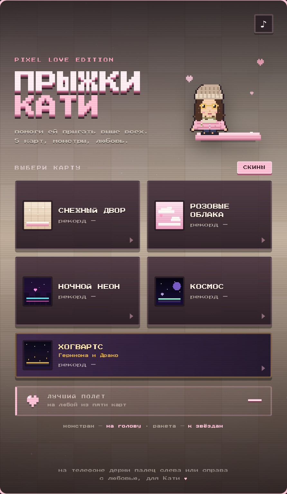
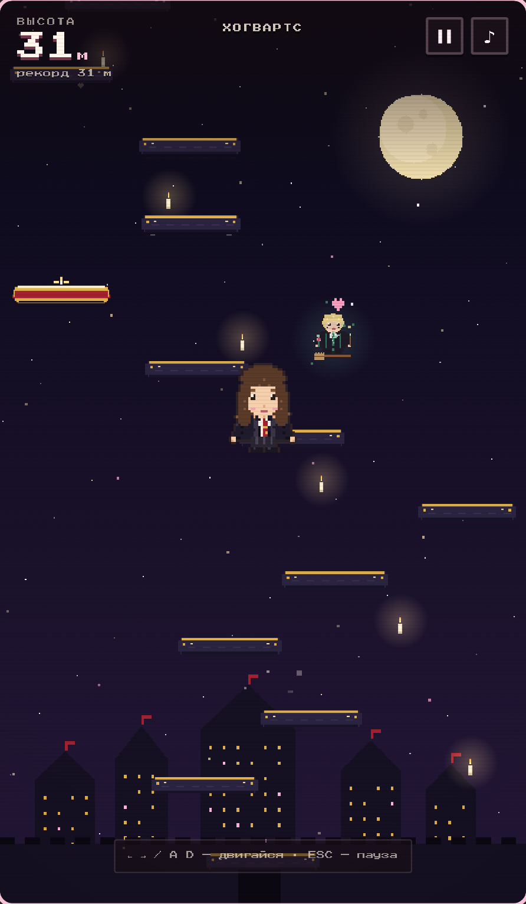

# Прыжки Кати

**Играть онлайн:** https://regentx.github.io/doodle_kate/

Маленькая пиксельная игра в духе Doodle Jump — один файл, работает офлайн.
Образы Кати собраны по фотографиям: зимний пуховик, рожки и синий свитер,
чёрный театральный блеск и офисный бордо с круглыми очками.
А на отдельной карте **Хогвартс** Катя становится Гермионой, и её встречает
Саша в образе Драко.





## Запуск

Открой `index.html` двойным щелчком (Chrome / Safari / Firefox).
Или из терминала:

```bash
open index.html
```

## Управление

- **← →** или **A D** — движение
- **ESC / P** — пауза
- **Space / Enter** — старт, рестарт, продолжить
- На телефоне — держи палец на левой или правой половине экрана
- На обычного монстра прыгай сверху; сбоку он опасен
- В Хогвартсе Саша — не опасный монстр: если он тебя поймает, будет любовная сцена

## Что внутри

- 5 карт: **Снежный двор**, **Розовые облака**, **Ночной неон**, **Космос**, **Хогвартс**
- 4 образа Кати, выбор сохраняется; в Хогвартсе — отдельный образ Гермионы
- на Хогвартсе летает Саша в образе Драко, с метлой, розой и палочкой
- у каждой своя гравитация, платформы, фон, частицы и сложность
- обычные, движущиеся, хрупкие (разваливаются), призрачные (мигают),
  исчезающие после прыжка и батуты
- золотые пружинки подбрасывают выше
- монстры у каждой карты свои: снегирь, злая тучка, дрон, НЛО и Саша-Драко
- на монстра можно прыгнуть сверху — он лопается; столкновение сбоку опасно
- бонусы: ракета (полёт вверх) и щит-сердечко (спасает один раз)
- счётчик побеждённых монстров на экране и в итогах забега
- эффекты: осколки платформ, вспышки, тряска, след ракеты, пузырь щита
- рекорд по каждой карте сохраняется в localStorage
- звук на WebAudio, кнопка **♪** отключает его
- никаких внешних файлов: шрифт и спрайты встроены

## Скины

В меню нажми **«СКИНЫ»**:

- **Зимняя** — пуховик, шапка и шарф
- **Чёртик** — рожки, синий свитер и серебряное сердечко
- **Театр** — чёрный блестящий блейзер и золотой ремень
- **Офис** — бордо, круглые очки и серые брюки в полоску

Выбранный образ сохраняется в localStorage и используется в игре.
Он не влияет на физику — только на внешний вид.

**Гермиона** — отдельный образ только для карты **Хогвартс**; Катя
переодевается в неё автоматически при старте этой карты.

## Хогвартс и Саша

Пятая карта — **Хогвартс**: ночное небо, замок, летающие свечи и золотые
платформы. Катя автоматически становится Гермионой — тёмная мантия,
белая рубашка и красно-золотой галстук Гриффиндора.

На карте появляется **Саша в образе Драко**: светлые волосы, мантия
Слизерина, метла, роза и волшебная палочка. Если он тебя поймает,
игра не заканчивается — включается любовная анимация
**«From Sasha with Love»** с сердечками и признанием. После неё полёт
продолжается, а Катя получает большой дружеский подскок.

## Как поменять имя

В `index.html` найди:

- `ПРЫЖКИ` и `КАТИ` — заголовок в меню
- `для Кати` — подпись внизу
- `Прыжки Кати` в `<title>` при желании

Имя можно поменять на любое другое — просто замени текст в этих местах.

## Как поменять цвета персонажа

В начале скрипта найди `const SKINS = [...]` — это массив образов.
У каждого есть `palette` с hex-цветами и `idle`/`blink` с пиксельными
рядами. Меняй цвета в `palette` и сохраняй файл. Гермиона — последний
элемент массива с `id: 'hermione'`.

## GitHub Pages

Как выложить игру в интернет — см. [DEPLOY.md](DEPLOY.md).

## Технически

- Canvas 420×720, пиксельный рендер с целым масштабом
- физика с фиксированным шагом 1/120 c
- параллакс-фоны, частицы, squash & stretch
- без сборки и зависимостей: только HTML + CSS + JS
